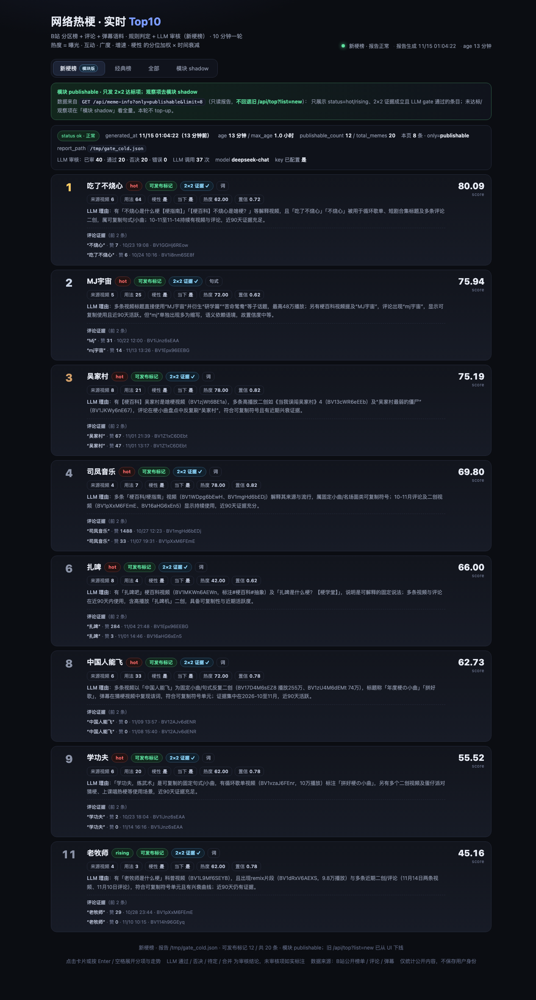

# 新梗榜切换模块版交付报告（旧 `list=new` 从 UI 下线）

- 会话：new-tab-switch（2026-11-15 01:08–01:20，session `c78d57d1-4908-417a-b4ed-5df76694e866`）
- 基线：HEAD `3a2f381`
- 目标：把看板「新梗榜」tab 的数据源从 `/api/top?list=new` 切到 `GET /api/meme-info?only=publishable&limit=8`；旧 `list=new` 从 UI 下线（API 不动）；「模块 shadow」保留 `only=all` 全量；经典/全部仍走 `/api/top`。
- 结论：**达成**。新梗榜请求只有 `/api/meme-info?...only=publishable`，全会话 `/api/top?list=new` 为 **0**；经典/全部/模块 shadow 行为不变；ok/stale/missing/invalid 与 publishable 空态均按预期展示；console/page/http errors 全 0。

---

## 1. 改动文件

| 文件 | 类型 | 说明 |
|---|---|---|
| `app/static/index.html` | 修改（+167 / −36 行） | 新梗榜改读 `/api/meme-info?only=publishable&limit=8`；新增 `#newView` 视图、模块版徽标、空/降级态；`refresh()` 增加模块数据源分派；复用 shadow 的卡片/头部渲染（抽出 `moduleHeadHtml` / `applyModuleStatus` / `setAlert` 三个共享 helper，shadow 输出不变） |
| `docs/pm/assets/new-tab-module.png` | 新增 | 新梗榜模块版桌面全页截图（1265×2358，654 KB，8 张 publishable 卡） |
| `docs/pm/NEW-TAB-SWITCH.md` | 新增 | 本报告 |

未触碰（`git status` 核对）：`app/*.py`（含 `api.py`/`meme_info_adapter.py`）、`tests/**`、`data/**`、`README*`、`docs/01-02`、`meme_info/**`、`tools/**`。未 commit。`.archify/` 是工作区既有未跟踪目录，本会话未改。

## 2. Tab 行为

### 2.1 结构

```html
<button class="tab" id="tab-new" role="tab" data-tab="new"
        aria-controls="newView" ...>新梗榜<span class="tab-badge">模块版</span></button>

<section id="newView" class="shadow-view" role="tabpanel" aria-labelledby="tab-new" hidden>
  <div class="shadow-banner new-banner" role="note">
    <b>模块 publishable · 只发 2×2 达标项；观察项去模块 shadow</b>
    <span class="sb-sub">数据来自 GET /api/meme-info?only=publishable&limit=8（只读报告，不回退旧 /api/top?list=new）：…</span>
  </div>
  <div id="newHead" class="shadow-head" aria-live="polite"></div>
  <div id="newAlert" class="notice" role="status" aria-live="polite" hidden></div>
  <div id="newList" aria-busy="false">…</div>
</section>
```

- 新梗榜 tab 文字保留「新梗榜」，后跟「模块版」小徽标（`title` 写明读哪个接口、旧 `list=new` 已下线）。
- 新梗榜与模块 shadow 各自独立容器（`#newList` / `#shadowList`），与 `/api/top` 的 `#list` 完全隔离；shadow 视图内 `.panel` 数量仍为 0。
- `aria-controls` 由 `list` 改为 `newView`；`role=tabpanel` + `aria-labelledby` + `#newList aria-busy` 沿用既有 a11y 模式；卡片复用 shadow 的 `role="group"` + `aria-label`。
- 桌面 4 tab 布局不变；≤640px 沿用 shadow-tab 已落地的 2×2 tab 栅格，390px 实测无溢出。

### 2.2 切换与刷新分派

```js
async function refresh(){
  if(currentTab === "shadow"){ return refreshShadow(); }
  if(currentTab === "new"){ return refreshNew(); }   // 只读模块，绝不请求 /api/top
  ... fetch("/api/top?list=" + encodeURIComponent(tab) + "&limit=10")
}
```

- 点击 / 方向键 / Home / End / localStorage 恢复继续走原 `setTab()`；`hotmeme.dashboard.tab.v2` 合法值仍是 `new|classic|all|shadow`，不升版。
- 新梗榜与 shadow 各自 30s 定时重取 `/api/meme-info`；SSE `onmessage` 对模块 tab 只维持连接状态、不消费 `/api/top` 快照；SSE 断线仍走原 `startPolling()` → `refresh()` → 模块 tab 自动分派，自愈行为不变。
- 列表 tab（经典/全部）的 `/api/top` 请求、`listSignature`、`render`、`updateStatus/updateMeta/updateLlm`、`historyEpoch` 与 sparkline 逻辑未改。

## 3. 请求矩阵（CDP 实测，8011）

| 操作 | 实际请求 | 说明 |
|---|---|---|
| 进入新梗榜 | `GET /api/meme-info?limit=8&only=publishable` ×1 | 仅此一个；无 `/api/top` |
| 重新加载页面（新梗榜为当前 tab） | `GET /`、`GET /api/meme-info?limit=8&only=publishable`、`GET /api/stream` | 无 `/api/top?list=new` |
| 切经典榜 | `GET /api/top?list=classic&limit=10` | 10 卡 |
| 切全部 | `GET /api/top?list=all&limit=10` | 10 卡 |
| 切模块 shadow | `GET /api/meme-info?limit=10&only=all` | 10 卡（`only=all` 全量，未被新梗榜影响） |
| 全程 `/api/top?list=new` | **0 次** | CDP 记录 0；8011 服务端日志 `list=new` 0 次 |

> 验证期间发现一台前序会话遗留的 headless Chrome（旧 profile）旧页面在 8011 上重连并轮询，已关闭；上表取自本次新开页面的 CDP 网络记录，8011 服务端日志同样 0 次 `list=new`。

## 4. 展示内容

### 4.1 顶部（`#newHead`，严格对应 API 字段）

`status` 徽标（ok/stale/missing/invalid）、`generated_at`（+相对时间）、`age / max_age`、`publishable_count / total_memes`、本页 `count` 条 + `only=publishable`、`report_path` `code`、LLM `verification`（已审/通过/否决/错误、调用次数、model、key 是否配置）。

### 4.2 卡片（复用 shadow 卡片渲染，字段与 `memes[]` 一一对应）

`rank`（前 3 高亮）、`canonical/family_key`、`score`（2 位小数）、`status`（hot 红 / rising 绿）、`publishable` 徽标（可发布标记）、`evidence_rate_2x2` 徽标（2×2 证据 ✓）、`meta_count`（来源视频）/`usage_count`（用法）、`verified` 摘要（梗性 / 当下 / 热度 / 置信 / LLM 理由 ≤200 字，截断带 title 全文）、`evidence` 前 2 条（quote + 赞 + ctime + bvid）、`meaning/type`（有则展示）。

本次 `gate_cold.json` 实测：`publishable_count=12 / total_memes=20`，`limit=8` 返回 8 条（rank 1,2,3,4,6,8,9,11——rank 为报告内序号，过滤后允许跳号）；8/8 带「可发布标记 + 2×2 证据 ✓」，8/8 有 verified 理由，每条 2 条评论证据。



## 5. 空态 / 降级态（实际页面验证）

| 场景 | 构造 | 页面行为 |
|---|---|---|
| publishable 为空 | 报告 memes 全 `evidence_rate_2x2=false` | `status ok` 仍显示；`#newList` 空态标题「本轮无 publishable」+ 说明「不 top-up、不回退旧新梗榜」+ 按钮「去模块 shadow 看全部/观察」「查看经典榜」「查看全部」；0 卡 |
| `stale` | `HOTMEME_MEME_INFO_MAX_AGE=60`（gate_cold age≈12min） | 仍展示 8 卡 + 金色警告条（含 generated_at / age / max_age）+ header「新梗榜 · 报告过期」、`updatedAt=age 12 分钟`、head 内 age 字段 |
| `missing` | 报告路径不存在 | 红色警告条 + 空态「模块 publishable 报告缺失」（路径 + 生成命令 + 不回退 `list=new`）+ 0 卡；header「报告缺失」 |
| `invalid` | 坏 JSON | 红色警告条 + 空态「模块 publishable 报告无效」+ adapter `error` 原文 + 0 卡；header「报告无效」 |
| fetch 失败 | 服务不可达 | header 灰点「服务未连接」+ `paintNotice` 重试提示；保留已有卡片不闪空；30s 轮询自愈 |
| 旧 API 缺字段 | `stats/verification/generated_at` 缺失 | 分别降级为「报告未提供 stats」「已审 0…、model 未配置」「按文件 mtime 估龄」，不抛错、不显示 undefined |

四态均 console/page errors=0、HTTP≥400=0、无横向溢出（8012 临时端口 + `/tmp` 报告副本验证，未写生产库、未跑采集）。

## 6. 验证

### 6.1 启动（任务指定命令，只读副本，不碰 8000/生产库）

```bash
cp /tmp/shadow-web.db /tmp/newtab-web.db
HOTMEME_PORT=8011 HOTMEME_HOST=127.0.0.1 HOTMEME_DB=/tmp/newtab-web.db \
HOTMEME_DISABLE_SCHEDULER=1 HOTMEME_OFFLINE=1 \
HOTMEME_MEME_INFO_REPORT=/tmp/gate_cold.json .venv/bin/python run.py
```

### 6.2 HTTP（8011）

| 路径 | 结果 |
|---|---|
| `GET /` | 200 |
| `GET /api/meme-info?only=publishable&limit=8` | 200；`status=ok, count=8, publishable_count=12, total_memes=20, age≈789s`；8 条全 publishable |
| `GET /api/meme-info?limit=10&only=all` | 200（shadow tab 用） |
| `GET /api/top?list=classic&limit=10` | 200 |
| `GET /api/top?list=all&limit=10` | 200 |

### 6.3 Chrome 157 headless（CDP 驱动，独立 profile）

| 检查项 | 结果 |
|---|---|
| console errors / page exceptions / Log errors / HTTP≥400 | **0 / 0 / 0 / 0** |
| 新梗榜网络 | 仅 `GET /api/meme-info?limit=8&only=publishable`；`/api/top?list=new` **0** |
| 新梗榜卡片 | 8 卡；8 可发布标记、8 个 2×2 ✓、8 个 hot/rising、8 条 verified 理由、24 条评论证据 DOM 节点（每条 2 条 + 小标题） |
| 桌面 1280 横向溢出 | 无（`scrollWidth 1265 ≤ innerWidth 1280`） |
| 移动 390×844 横向溢出 | **0**（`scrollWidth=390`），tab 2×2（坐标实测两列两行），8 卡可见 |
| 经典 / 全部 | `/api/top?list=classic|all` 各 1 次、各 10 卡，溢出 0 |
| 模块 shadow | `/api/meme-info?limit=10&only=all` 1 次、10 卡、`onlyHint=only=all · 全量对比（默认）`、「只看可发布」逻辑未动 |
| reload（当前 tab=new） | 仍选中 new、只发 publishable、无 `/api/top` |
| 键盘 | new 上 `ArrowRight` → 经典榜，`aria-selected`/localStorage 同步 |
| sparkline / 展开 | 全部 tab 点第一张卡 → 1 次 `/history`、`.spark-svg` 渲染、`aria-expanded=true`（行为不变） |
| 截图 | `docs/pm/assets/new-tab-module.png`，1265×2358，654,103 B |

### 6.4 静态检查

- 内联 `<script>` 提取后 `node --check`：**通过**；`id` 无重复（28 个）；
- 全页唯一 `/api/top?list=` 拼接点在 `refresh()`，`currentTab` 只可能是 `classic|all`；`/api/top?list=new` 仅出现在说明文字与注释里，无请求路径；
- 无外链/CDN/新依赖（仍单文件内联 CSS/JS）。

清理：验证后已关闭 8011（`kill`），关闭临时状态端口 8012 与 headless Chrome；8000 未启动、未触碰；未写 `data/hotmeme.db`（DB 副本在 `/tmp/newtab-web.db`）；未跑采集。`/tmp/newtab-*.json` 为状态测试临时报告副本，未入库。

## 7. 已知限制

1. **只发 publishable，不 top-up**：新梗榜只展示 `status∈(hot,rising)` + 2×2 + LLM gate 通过的条目；2×2 未过 / 观察项 / 被 gate 否决项**只**在「模块 shadow」`only=all` 可见，新梗榜不会为了凑 10 条回退或补位。条数随报告波动（本轮 8，此前单轮 publishable Top10 约 7–8）。
2. **rank 可能跳号**：模块 `rank` 是报告内序号，`only=publishable` 过滤后允许 1,2,3,4,6,8,9,11 这种跳号，不等于主榜名次，也不做重排。
3. **不接 SSE 推送**：`/api/meme-info` 无推送通道；新梗榜靠进入 tab、30s 定时器或手动 reload 重取，报告新鲜度取决于 `tools/meme_info_shadow.py` 是否在跑（本页不触发采集、不写库）。
4. **无 sparkline/展开走势**：与 shadow 同——模块 family 不在 app DB 的历史维度里，混用会误导；sparkline 仍只在经典/全部保留。
5. **stale 只标注不拦截**：按需求过期报告仍展示，需看 header/updatedAt 的 age 判断时效。
6. **旧 `/api/top?list=new` API 未下线**：本会话边界是不改 `app/*.py`；UI 已不再请求，保留 API 作为 JSON 回滚途径，后续是否删除由 app 侧决定。
7. **仅 Chrome 157 headless 验证**：未测 Safari/Firefox。
8. **数据时段不同**：8011 用 cycle 24 旧 DB 副本 + `gate_cold.json`（01:04 生成）验证展示与隔离性，不代表两套榜单的质量对比结论。
9. 移动端 tab 2×2 是 shadow-tab 已交付的布局，本次沿用未改。

## 8. 复现

```bash
# 1) 服务（只读副本 + gate_cold 报告）
cp /tmp/shadow-web.db /tmp/newtab-web.db
HOTMEME_PORT=8011 HOTMEME_HOST=127.0.0.1 HOTMEME_DB=/tmp/newtab-web.db \
HOTMEME_DISABLE_SCHEDULER=1 HOTMEME_OFFLINE=1 \
HOTMEME_MEME_INFO_REPORT=/tmp/gate_cold.json .venv/bin/python run.py

# 2) 接口
curl -s -o /dev/null -w '%{http_code}\n' 'http://127.0.0.1:8011/'
curl -s 'http://127.0.0.1:8011/api/meme-info?only=publishable&limit=8' | head -c 300
curl -s -o /dev/null -w '%{http_code}\n' 'http://127.0.0.1:8011/api/top?list=classic&limit=10'

# 3) 截图（headless；CDP automation 脚本在 /tmp/newtab-cdp.js，未入库）
"/Applications/Google Chrome.app/Contents/MacOS/Google Chrome" --headless=new --no-sandbox \
  --disable-gpu --user-data-dir=/tmp/newtab-chrome --window-size=1280,1000 \
  --screenshot=/tmp/newtab.png 'http://127.0.0.1:8011/'
# 截图为新梗榜需先在页面选中该 tab（localStorage hotmeme.dashboard.tab.v2=new）或 CDP 点击

# 4) 状态机 UI：换 env 重启（stale=HOTMEME_MEME_INFO_MAX_AGE=60；missing=指向不存在路径；invalid=坏 JSON；
#    empty publishable=报告 memes 全 evidence_rate_2x2=false），端口可用 8012。
```
