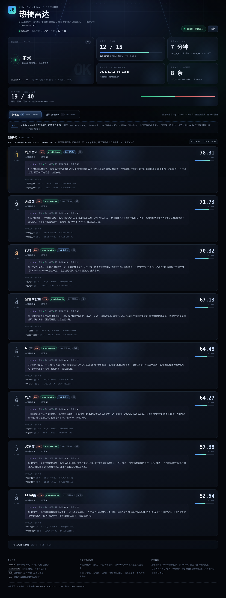
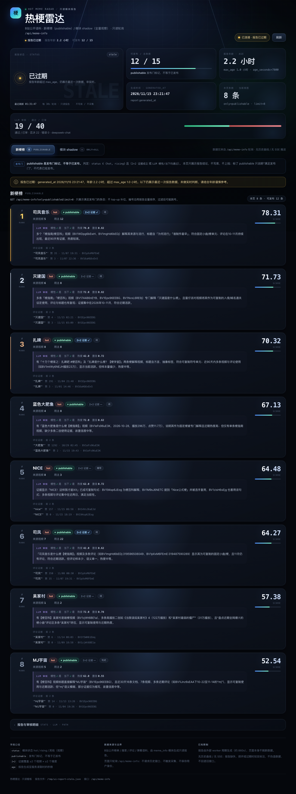
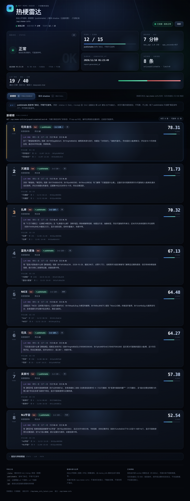

# 前端 UI：两 tab 只读看板（Aceternity 风格重做）

- 日期：2026-11-16
- 范围：`app/static/index.html`（单文件、无新依赖、无 CDN/外部字体/构建步骤）
- 两轮迭代：
  1. 重做两 tab 数据看板并清理旧榜死代码（commit `eb43104`）；
  2. 参照 **Aceternity UI** 的视觉语言做二次视觉/交互升级（本次，仅 CSS + 原生 JS，不引入 React/Tailwind/Motion）。
- 结论：**完成**。页面只轮询 `GET /api/meme-info`（`only=publishable` / `only=all`）；桌面 1280 / 移动 390 无横向溢出；console/page/http error 全 0；ok / stale / missing / invalid / empty / 离线状态均实际验证；XSS 转义实测通过。



## 1. Aceternity 参考映射

参考站点：<https://ui.aceternity.com/components>。只借鉴其**视觉语言与布局/动效思路**，全部用原生 CSS/vanilla JS 复刻；未复制其 React 源码。

| Aceternity 组件 | 本项目实现（原生 CSS/JS） | 说明 |
|---|---|---|
| Spotlight / Spotlight New | `.scene-spotlight`：顶部中央超大椭圆径向渐变 + `blur(46px)` + 12s 缓慢呼吸；`.scene-beam-a/b` 两条旋转渐变光柱 | 用 fixed 背景层实现，不阻塞内容；不跟随鼠标做全页聚光，避免数据看板晃动 |
| Dotted Glow Background | `.scene-dots`：22px 点阵 + `radial-gradient` 遮罩 + 10s 透明度呼吸 | 点阵只在 hero 下方微弱发光，不铺满全页 |
| Grid and Dot Backgrounds | `.scene-grid`：64px 横竖网格 + 顶部椭圆遮罩淡出；`.bento-status` 内部 30px 网格装饰 | 作为结构背景，透明度 ≤0.06 |
| Gradient Animation / Aurora Background | `.scene-aurora-a/b`：蓝/薄荷两个大模糊色团，30–36s 缓慢漂移（`mix-blend-mode:screen`） | 低透明度、无频闪；`prefers-reduced-motion` 下完全停止 |
| Background Beams | `.scene-beam-a/b`：2px 渐变光柱，`drop-shadow` 发光，左右对称倾斜 | 替代 SVG path 光束，零依赖、低成本 |
| Bento Grids | `.bento`：12 栏非对称 Bento 状态板（status 跨 5 列 2 行，pub/age/gen/page/LLM 不等宽） | 保留全部原有数据字段，仅重排视觉 |
| Card Hover Effect / Glowing Effect | `.meme-card` 指针跟随径向高光（`--mx/--my`）+ `::after` mask 渐变描边（hover 时 0.95） | 用 `pointermove` 委托 + rAF 节流；仅在 fine pointer 生效 |
| 3D Card Effect / Wobble Card | 卡片 `perspective(1200px) rotateX/rotateY`（最大 ±2.2°，`--rx/--ry`），hover 抬升 3px；`is-tilting` 时过渡降至 90ms | 克制倾斜，保持文字可读；reduced-motion 或触屏（coarse pointer）下完全关闭 |
| Text Animations | hero 标题渐变文字 + 14s 缓慢 sheen；`hero-in`、`bento-in`、`card-in` 入场；live dot 呼吸 | 只做一次入场与低频循环，数据刷新不重播 |
| Stats Sections | Bento 大数字（publishable / age / LLM）+ `pubMeterFill` 进度条 + LLM 审核堆叠条（ok/no/err 三段，真实计数） | 所有数字/宽度来自 API，不做假图表 |
| Empty States | `.state` 径向光晕 + 两圈虚线旋转轨道 + 原生按钮 | 空/缺失/损坏/离线共用，但仍由文案区分语义 |
| Signal / 大面积背景文字 | 状态瓦片背景大号 `OK / STALE / MISSING / INVALID / OFF` 水印 | 呼应 Aceternity 的大字装饰，`aria-hidden`、低对比 |

**未采用**：Meteors / Sparkles / Background Beams with Collision / Canvas Reveal / WebGL shader 类效果（需要 canvas 或高频动画，数据看板会变成 landing page 且增加性能开销）；全页鼠标 spotlight（与卡片 spotlight 冲突且干扰阅读）；文字打字机/乱码动画（降低可读性）；React 组件、Tailwind 类名、Motion 依赖、CDN/外部字体；浅色主题切换（本页定位为单一深色数据看板）。

## 2. 设计目标

1. **先看报告状态，再看榜单**：hero 摘要（报告状态/年龄/可发布数）+ Bento 状态板（status、generated_at、age/max_age、publishable/total、本页条数、LLM 审核），避免把过期数据当实时数据。
2. **publishable 不歧义**：全页明确“**publishable 是发布门标记，不等于已发布**”，卡片把 `publishable`、`2×2 证据`、LLM 结论拆成三个独立徽标。
3. **可解释优先**：新梗榜卡片保留 LLM 结论（梗性/当下/热度/置信）与完整理由、前 2 条评论证据，便于人工复核。
4. **两个视图角色分明**：新梗榜是“发布门视图”（实线玻璃卡、蓝青高光）；模块 shadow 是“全量观察视图”（虚线、紫色 accent、OBSERVE banner、观察徽标）。
5. **不伪造数据**：缺失/损坏/过期/全量为空时显示对应状态与原始 `report_path`/`error`，不补位、不回退旧接口、不显示猜测值。
6. **克制的高级感**：动效服务于层级而不是抢戏；数据可读性、键盘可访问、移动端与 reduced-motion 优先。

## 3. 信息架构

```
Scene        fixed 背景层：grid / dots / spotlight / beams / aurora / vignette（纯装饰，aria-hidden）
Hero         品牌 + 渐变大标题 + 副标题 + hero-meta（报告状态 / 报告年龄 / 可发布）+ 连接 pill + 刷新
Bento        6 张玻璃瓦片：报告状态(大) / 可发布·总条数 / 报告年龄 / 生成时间 / 本页条数·scope / LLM 通过·已审
Viewbar      新梗榜（publishable）｜模块 shadow（only=all）        ← 方向键 / Home / End
Policy       “publishable 是发布门标记，不等于已发布” + 判定公式
Notice       stale / missing / invalid / 离线 / 预算耗尽解释条
Active View
  ├─ 新梗榜        排名卡片：rank · canonical · status · publishable · 2×2 · type
  │                meta/usage · LLM 结论+理由 · 前 2 条证据 · score（满分 100 细条）
  └─ 模块 shadow   OBSERVE banner + 全量卡片（虚线、观察徽标、紫色 rank、同字段）
Details      <details> 报告与审核明细：stats / verification / report_path / age 原始值
Footer       字段口径 · 数据来源与边界 · 已知限制 · 报告路径
```

- 状态板与 notice 分离：Bento 是稳定摘要，notice 只在需要解释时出现。
- 报告级字段在切换 tab 时保持一致；`本页条数/only/limit` 随当前视图变化，避免把“本页 8 条”误读成“全站 8 条”。

## 4. 视觉系统与动效

- **背景**：近黑 `#05070c`；顶部 64px 网格 + 22px 点阵 + 中央椭圆 spotlight + 两条斜向光柱 + 蓝/薄荷 aurora 色团。全部 `position:fixed`、`pointer-events:none`、`z-index:0`，内容层 `z-index:1`。
- **层次**：hero（大字号渐变标题）→ Bento（玻璃卡片、大数字）→ tabs/policy → 数据卡片（信息密度最高）→ details/footer（弱化）。
- **玻璃卡**：`linear-gradient` + `backdrop-filter: blur(...)` + 1px 低对比边框 + inset 顶部高光；hover 时边框/外发光变化，位移 ≤3px。
- **语义色**：绿=ok/publishable/LLM通过，琥珀=stale/预算耗尽/错误，红=invalid/missing/LLM否决，紫=观察视图/LLM 审核框，蓝=2×2/信息。
- **字体**：系统字体栈 + `ui-monospace` 数字/时间；全部 `tabular-nums`。
- **动效清单**：scene 呼吸/漂移、hero 入场 + 标题 sheen、bento 错峰入场、卡片 hover 高光/轻倾斜、loading spinner、live dot 呼吸。所有循环动画周期 ≥10s，无闪烁；`prefers-reduced-motion: reduce` 下全部关闭（含 scene、bento、卡片 transform、状态轨道、spinner）。
- **断点**：1280（12 栏 Bento：5/4/3 + 4/3 + 12）、≤1000（status 通栏、其余 2 列、卡片 score 下移）、390（2 列 Bento、hero 纵向堆叠、tab 等宽，无横向滚动）。

## 5. 组件与 API 字段映射

| 组件 | 字段 | 说明 |
|---|---|---|
| hero-meta | `status` / `age_seconds` / `publishable_count/total_memes` | 顶部快速摘要，与 Bento 同源 |
| Bento status | `status` | 中文 + 原始 code chip + `data-tone` 驱动光球/水印（OK/STALE/…） |
| Bento publishable | `publishable_count / total_memes` | 大数字 + 真实比例进度条，副文案强调“不等于已发布” |
| Bento age | `age_seconds` / `max_age_seconds` | 友好化 + max_age 与原始秒数 |
| Bento generated | `generated_at` | 缺失时“未提供”，注明按文件 mtime 估龄 |
| Bento 本页 | `count` + 当前 tab 的 `only/limit` | 明确“本页”不是全量 |
| Bento LLM | `verification.ok/attempted/rejected/errors/model` | 大数字 + ok/no/err 堆叠条（宽度由真实计数计算） |
| 卡片 rank | `rank` | 报告全量序号，过滤后允许跳号；`sr-only` 读作“报告全量排序第 N 位” |
| 卡片标题 | `canonical`（回退 `family_key`） | 缺失时“未命名条目”，不编造 |
| status 徽标 | `status` | hot 红 / rising 绿 / 其他中性 |
| publishable 徽标 | `publishable` | true=“publishable”，false=“未达发布门”；title 写明公式与“≠已发布” |
| 2×2 徽标 | `evidence_rate_2x2` | true=“2×2 证据 ✓”，false=“2×2 证据 —”；title 解释 2 视频 × 2 维度 |
| type / metrics | `type` / `meta_count` / `usage_count` | 有值才渲染；缺失显示“—” |
| meaning | `meaning` | 有值才渲染段落；当前报告普遍为空，不占位刷屏 |
| LLM 框 | `verified.is_meme / is_current / heat / confidence / reason / error` | 未提供时明确“报告未提供该条审核结论” |
| 证据 | `evidence[0..1]` 的 `quote/like/ctime/bvid` | 最多前 2 条；无证据时“报告未提供评论证据” |
| score | `score` | 2 位小数 + 0–100 细条；缺失显示“—” |
| 明细 | `stats.*` / `verification.*` / `report_path` / `age_seconds` / `max_age_seconds` | 只展示 API 实际返回字段，缺失写“报告未提供 stats” |

## 6. 状态与空态（全部实际验证）

| 场景 | 构造 | 页面行为 |
|---|---|---|
| `ok` | 线上报告（01:23 生成，15 条 / 12 条 publishable） | 绿色“正常（ok）”；Bento 水印 OK；新梗榜 8 卡；shadow 10 卡；无 notice |
| `stale` | 临时副本 `generated_at` 改为 2h10m 前，默认 max_age=3600 | 琥珀“已过期（stale）”；notice 写明 generated_at / age 2.2 小时 / max_age 1.0 小时；仍展示 8 卡并明确“未做实时判断” |
| `missing` | `HOTMEME_MEME_INFO_REPORT` 指向不存在路径 | 红色“缺失（missing）”；两个 tab 均显示“报告文件缺失”+ 实际路径；0 卡；不伪造 |
| `invalid` | 坏 JSON | 红色“损坏（invalid）”；显示 adapter 原文 `JSONDecodeError...`；0 卡；不猜测、不修复 |
| memes 为空（`ok`） | 合法 schema + `memes: []` | 新梗榜“本轮没有可发布条目”+ 去 shadow 按钮；shadow“报告全量列表为空” |
| 离线 / 请求失败 | 页面加载后 CDP 断网 + 点击刷新 | header 变红“服务连接失败”；notice 说明；**保留上一次成功数据**不闪空；恢复网络后刷新回到正常 |
| 预算耗尽 | `stats.budget_exhausted=true` | 琥珀 notice 提示“条目可能不完整”（线上当前为 false） |
| 未知 status | 非 ok/stale/missing/invalid | 琥珀“未知报告状态”，按未验证处理，不推断 |



## 7. 交互与可访问性

- 轮询：仅当前 tab 每 30 秒请求一次；页面隐藏时暂停，回到前台立即补一次；手动“刷新”同一路径；请求带 `cache:no-store` + `reqSeq` 丢弃过期响应。
- 请求矩阵（CDP 网络记录）：打开页面 `GET /` + `GET /api/meme-info?limit=8&only=publishable`；切模块 shadow `GET /api/meme-info?limit=10&only=all`；移动端重载同样只发这两类。全程无 `/api/top`、`/api/meme/*/history`、`/api/stream`、`/api/health`、`/api/refresh`。
- Tab：`role=tablist/tab/tabpanel`，`aria-selected` + roving `tabindex`；支持 `← → Home End`；选择写入 `localStorage["hotmeme.ui.tab.v3"]`，非法旧值回退 `new`。
- 指针效果：`pointermove` 事件委托到 `.meme-card`，`requestAnimationFrame` 节流，设置 `--mx/--my/--rx/--ry`；只在 `(hover:hover) and (pointer:fine)` 且未开启 reduced-motion 时启用；触屏/减少动态时卡片保持静态。
- 键盘：CDP `ArrowRight` 实测可切 tab 且 `aria-selected`/面板显隐同步；所有按钮/链接可聚焦，`:focus-visible` 2px 外框；顶部 skip link。
- 读屏：`connPill`、hero-meta、notice 为 `aria-live=polite`；列表容器 `aria-busy`；卡片 `<ol>/<li>/<article>` + `h3` + `aria-labelledby`；score 条 `role=img` + aria-label；rank 提供 `sr-only` 文本；纯装饰层（scene、水印、meter）`aria-hidden`。
- 转义：所有 API 字符串统一 `esc()` 后进入 `innerHTML`；style 宽度只来自数字计算并 clamp；无外链资源、无 CDN、无 `eval`。
- 安全验证：伪造报告注入 ``、`<script>`、`<svg onload>` 到 canonical/meaning/type/reason/evidence 后，`window.__xss*` 全 undefined、注入节点 0、`/<script>/<svg onload>` 后 `window.__xss*` 全 undefined、注入节点 0、字面文本渲染 |
| 网络 | 仅 `GET /` 与 `GET /api/meme-info?...`；无 `/api/top`、history、stream、health、refresh |

截图（Chrome headless + CDP `Page.captureScreenshot` full page；自动化脚本为 `/tmp` 临时文件，未入库）：
桌面新梗榜 1280×3372、hover 1280×3372、移动端 390×4953、stale 1280×3431。

复现（临时服务，验证后已关闭）：

```bash
cd /Users/wanjunqiang/Desktop/hot_meme_search
HOTMEME_PORT=8011 HOTMEME_HOST=127.0.0.1 \
HOTMEME_MEME_INFO_REPORT=/tmp/meme_info_latest.json \
  .venv/bin/python run.py

curl -s -o /dev/null -w 'GET / -> %{http_code}\n' http://127.0.0.1:8011/
curl -s 'http://127.0.0.1:8011/api/meme-info?limit=8&only=publishable' | head -c 300
curl -s -o /dev/null -w 'GET all -> %{http_code}\n' 'http://127.0.0.1:8011/api/meme-info?limit=10&only=all'
```

## 10. 已知限制

1. **环境动效是纯装饰**：fixed 背景层使用 blur/radial-gradient，低端设备可能有额外合成开销；已压到低透明度、少元素、`contain` 未加但层级简单；reduced-motion 下全部停止。
2. **指针效果仅桌面**：hover 高光 + 3D 倾斜只在 `(hover:hover) and (pointer:fine)` 且非 reduced-motion 时启用；触屏/键盘不依赖它。
3. **非当前 tab 不轮询**：首屏只请求当前视图，另一个 tab 的计数在首次点击前显示“–”。
4. **页面不生产数据**：报告由外部 worker 生成（约 860s 一轮），age/stale 是报告新鲜度，不是页面刷新时间。
5. **publishable 不 top-up**：过滤后可能不足 8 条，`rank` 会跳号；`publishable_count/total_memes` 是报告级计数，不等于本页条数。
6. **shadow 只显示前 10 条**（`only=all&limit=10`）；更多条目直接读 API。
7. **无历史曲线 / 无 SSE / 无发布动作**：与后端能力一致，页面不请求也不伪造。
8. 当前线上报告 `meaning` 基本为空，卡片只在有值时显示含义。
9. 仅 Chrome 157 headless 验证；未在 Safari/Firefox 与真实读屏软件下人工验收（键盘交互用 CDP 模拟）。
10. 截图为 2026-11-16 01:23 报告快照与临时 stale 副本，不是固定 fixture；报告变化会导致数字/条数不同。
11. 截图 PNG 未压缩（约 1.3–2.1 MB/张），与仓库既有 PM 截图同量级。

## 11. 文件清单与边界

| 文件 | 类型 | 说明 |
|---|---|---|
| `app/static/index.html` | 重写/升级 | 两 tab 只读看板 + Aceternity 风格场景/Bento/卡片动效；单文件内联 CSS/JS；无新依赖 |
| `docs/pm/UI-DESIGN.md` | 更新 | 本设计/清理/验证报告（含 Aceternity 参考映射） |
| `docs/pm/assets/ui-desktop.png` | 更新 | 桌面 1280 · 新梗榜全页截图 |
| `docs/pm/assets/ui-mobile.png` | 更新 | 移动 390 · 新梗榜全页截图 |
| `docs/pm/assets/ui-hover.png` | 新增 | 桌面 hover 态（卡片高光 + 轻倾斜） |
| `docs/pm/assets/ui-stale.png` | 更新 | 过期状态（stale）桌面截图 |

未触碰：`app/*.py`、`meme_info/`、`tests/`、`data/`、`README.md`、`docs/01-02`、`docs/pm` 其他文件、8000 端口服务；未 commit。

## 12. 截图





