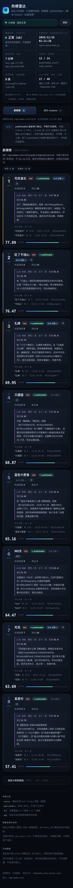

# 前端 UI 重做：新梗榜 / 模块 shadow

- 日期：2026-11-16
- 范围：`app/static/index.html`（单文件、无新依赖、无 CDN/外部字体/构建步骤）
- 目标：在“一个只读报告、两个视图”的现状下重做页面，清理旧榜死代码，把**报告新鲜度**和 **publishable 的语义**做成第一等信息，并让“模块 shadow”在视觉上明确区别于“已发布”。
- 结论：**完成**。页面只轮询 `GET /api/meme-info`（`only=publishable` / `only=all`），桌面 1280 / 移动 390 无横向溢出，console/page/http error 全 0，`ok / stale / missing / invalid / empty / 离线` 六类状态均实际验证。


## 1. 设计目标

1. **先看报告状态，再看榜单**：`status`、`generated_at`、`age / max_age`、`publishable_count / total_memes` 放在首屏状态板，避免用户把过期数据当实时数据。
2. **publishable 不歧义**：全页反复明确“**publishable 是发布门标记，不等于已发布**”，并在卡片上把 `publishable`、`2×2 证据`、LLM 结论拆成三个独立徽标，不合并成一个“已发布”。
3. **可解释优先**：新梗榜卡片保留 LLM 结论（梗性 / 当下 / 热度 / 置信）与完整理由、前 2 条评论证据，便于人工复核。
4. **两个视图角色分明**：新梗榜是“发布门视图”（实线卡片、高对比）；模块 shadow 是“全量观察视图”（虚线卡片、紫色 OBSERVE 标识、观察徽标），从视觉上就不可能误认为已发布。
5. **不伪造数据**：报告缺失 / 损坏 / 过期 / 全量为空时显示对应状态与原始 `report_path` / `error`，不补位、不回退旧接口、不显示猜测值。
6. **工程边界**：继续单文件、系统字体、深色数据看板；移动端 390px、键盘可访问、`prefers-reduced-motion`、所有插值转义；只轮询一个接口。

## 2. 信息架构

```
Header       品牌 / 一句话定位 · 连接状态 pill · 刷新按钮
Report Board 6 格状态板：status / generated_at / age·max_age / publishable·total / 本页条数·scope / LLM 通过·已审
View Tabs    新梗榜（publishable）｜模块 shadow（only=all）        ← 方向键 / Home / End 可切换
Policy       “publishable 是发布门标记，不等于已发布” + 判定公式
Notice       stale / missing / invalid / 离线 / 预算耗尽时的解释条
Active View
  ├─ 新梗榜        排名卡片：rank · canonical · status · publishable · 2×2 · type
  │                meta_count / usage_count · LLM 审核框（结论+理由）· 前 2 条证据 · score
  └─ 模块 shadow   OBSERVE banner + 全量卡片（虚线、观察徽标、紫色 rank、同字段）
Details      <details> 报告与审核明细：stats / verification / report_path / age 原始值
Footer       字段口径 · 数据来源与边界 · 已知限制 · 报告路径
```

- 状态板与 notice 是**两套信息**：状态板是稳定摘要，notice 只在需要解释时出现（过期原因、缺失路径、解析错误、连接失败）。
- 报告级字段（publishable 总数、总条数、LLM 统计、路径）在切换 tab 时保持一致；`本页条数` / `only` / `limit` 随当前视图变化，避免把“本页 8 条”误读成“全站 8 条”。
- 明细默认折叠，但 `<details>` 使用原生键盘/读屏行为，不引入 JS 折叠状态。

## 3. 视觉系统与响应式

- 深色数据看板：近黑底 + 蓝色/薄荷色 radial 光晕 + 26px 点阵网格；正文 `#e8eef8`，次级 `#bcc8da`，弱化 `#8492a8`；数值统一 `ui-monospace` + `tabular-nums`。
- 语义色：绿=ok/publishable/LLM通过，琥珀=stale/预算耗尽，红=invalid/missing/LLM否决，紫=观察视图/LLM 审核框，蓝=信息/2×2。
- 排名：前 3 名用金/银/铜左侧竖条 + 数字着色；其余为中性灰，避免整页高饱和。
- 卡片栅格：桌面 `rank | 内容 | score` 三栏（score 右对齐 + 100 分制细条），≤900px 时 score 落到卡片底部并横向展开；≤600px 收紧字号与间距。
- 三种断点实测：1280（三栏状态板、三栏卡片）、900（两栏状态板）、390（两栏 tab、无横向滚动）。
- 动效仅 `hover` 边框/位移与 loading spinner；`prefers-reduced-motion: reduce` 下全部时长压到 ~0 并取消 hover 位移与 spinner 旋转。

## 4. 组件与 API 字段映射

| 组件 | 字段 | 说明 |
|---|---|---|
| 状态 pill（header） | `status` + 请求状态 | ok/warn/bad 三色 + “已连接 · 报告正常/已过期/缺失/损坏”或“服务连接失败” |
| 状态板 status | `status` | 中文 + 原始 code（`正常（ok）`），副文案解释该状态含义 |
| 状态板 generated | `generated_at` | 缺失时显示“未提供”，并注明 age 按文件 mtime 估算 |
| 状态板 age | `age_seconds` / `max_age_seconds` | 友好化（秒/分钟/小时/天）+ 原始秒数 |
| 状态板 publishable | `publishable_count / total_memes` | 报告级计数 |
| 状态板 本页 | `count` + 当前 tab 的 `only/limit` | 明确“本页”不是全量 |
| 状态板 LLM | `verification.ok / attempted / rejected / errors / model` | 通过 / 已审 为主值，否决、错误、model 为副文案 |
| 卡片 rank | `rank` | 报告全量序号，过滤后允许跳号；`sr-only` 读作“报告全量排序第 N 位” |
| 卡片标题 | `canonical`（回退 `family_key`） | 缺失时显示“未命名条目”，不编造 |
| status 徽标 | `status` | hot 红 / rising 绿 / 其他中性；title 带原始值 |
| publishable 徽标 | `publishable` | true=“publishable”，false=“未达发布门”；title 写明公式与“≠已发布” |
| 2×2 徽标 | `evidence_rate_2x2` | true=“2×2 证据 ✓”，false=“2×2 证据 —”；title 解释 2 视频 × 2 维度 |
| type 徽标 | `type` | 可选，等宽小字 |
| metrics | `meta_count` / `usage_count` | 来源视频 / 用法；缺失显示“—” |
| meaning | `meaning` | 有值才渲染段落；当前报告普遍为空，因此不占位刷屏 |
| LLM 框 | `verified.is_meme / is_current / heat / confidence / reason / error` | 未提供时明确“报告未提供该条审核结论”，不用空值伪装通过 |
| 证据 | `evidence[0..1].quote / like / ctime / bvid` | 最多前 2 条；无证据时“报告未提供评论证据” |
| score | `score` | 2 位小数 + `role=img` 的 0–100 细条；缺失显示“—” |
| 明细 | `stats.*` / `verification.*` / `report_path` / `age_seconds` / `max_age_seconds` | 只展示 API 实际返回的字段，缺失写“报告未提供 stats” |

## 5. 状态与空态（全部实际验证）

| 场景 | 构造 | 页面行为 |
|---|---|---|
| `ok` | 线上报告（01:11 生成，14 条 / 13 条 publishable） | 绿色“正常（ok）”；新梗榜 8 卡；模块 shadow 10 卡；无 notice |
| `stale` | 临时报告副本，`generated_at` 改为 2 小时前，默认 max_age=3600 | 琥珀“已过期（stale）”；notice 写明 generated_at / age 2.1 小时 / max_age 1.0 小时；仍展示 8 卡，明确“未做实时判断” |
| `missing` | `HOTMEME_MEME_INFO_REPORT=/tmp/ui-report-does-not-exist.json` | 红色“缺失（missing）”；两个 tab 均显示“报告文件缺失”+ 实际路径；0 卡；不伪造 |
| `invalid` | 坏 JSON（截断 schema 前缀） | 红色“损坏（invalid）”；显示 adapter 原文 `JSONDecodeError: Expecting value...`；0 卡；不猜测、不修复 |
| memes 为空（`ok`） | 合法 schema + `memes: []` | 新梗榜“本轮没有可发布条目”+ 去 shadow 按钮；shadow“报告全量列表为空”；均不发请求补位 |
| 离线 / 请求失败 | 页面加载完成后 CDP 断网 + 点击刷新 | header 变红“服务连接失败”；notice 保留说明；**保留上一次成功数据 8 卡**不闪空；恢复网络后点刷新回到“已连接 · 报告正常” |
| 预算耗尽 | `stats.budget_exhausted=true` | 琥珀 notice 提示“条目可能不完整”（逻辑已接入；线上报告当前为 false） |
| 未知 status | 非 ok/stale/missing/invalid | 琥珀“未知报告状态”，按未验证处理，不推断 |


## 6. 交互与可访问性

- 轮询：仅当前 tab 每 30 秒请求一次；页面隐藏（`visibilitychange`）时暂停，回到前台立即补一次；手动“刷新”同一路径。请求带 `cache: "no-store"` + `reqSeq` 丢弃过期响应。
- 请求矩阵（CDP 网络记录，1280 页面完整会话）：
  - 打开页面：`GET /` + `GET /api/meme-info?limit=8&only=publishable`
  - 切模块 shadow：`GET /api/meme-info?limit=10&only=all`
  - 移动端重载：`GET /` + `GET /api/meme-info?limit=8&only=publishable`
  - 全程无 `/api/top`、`/api/meme/*/history`、`/api/stream`、`/api/health`、`/api/refresh`。
- Tab：`role=tablist/tab/tabpanel`，`aria-selected` + roving `tabindex`；支持 `← → Home End`；选择写入 `localStorage["hotmeme.ui.tab.v3"]`，非法旧值回退 `new`。
- 键盘：所有按钮/链接可 Tab 聚焦，`:focus-visible` 2px 外框；CDP `ArrowRight` 实测可切换 tab 且 `aria-selected` / 面板显隐同步。
- 读屏：`connPill`、notice 为 `aria-live=polite`；列表容器 `aria-busy`；卡片 `<ol>/<li>/<article>` + `h3` + `aria-labelledby`；score 条 `role=img` + aria-label；rank 提供 `sr-only` 文本；顶部有“跳到主要内容”skip link。
- 转义：所有 API 字符串（canonical / reason / evidence / report_path / error / model / family_key…）统一经 `esc()` 后进入 `innerHTML`；数字类 style 宽度只来自 `Number` 计算并 clamp；无外链资源、无 CDN、无 `eval`。
- 安全验证：伪造报告注入 ``、`<script>`、`<svg onload>` 到 canonical/meaning/type/reason/evidence 后，页面 `window.__xss*` 全为 `undefined`、注入节点数 0、`/<script>/<svg onload>` 后 `window.__xss*` 全 undefined、注入节点 0、字面文本渲染、console/exception 0 |
| 状态 | stale / missing / invalid / 空 memes / 离线+恢复 均按第 5 节展示，四态 console/exceptions 0、无横向溢出 |
| 网络 | 全程仅 `GET /` 与 `GET /api/meme-info?...`；无 `/api/top`、history、stream、health、refresh |

复现（临时服务，验证后已关闭）：

```bash
cd /Users/wanjunqiang/Desktop/hot_meme_search
HOTMEME_PORT=8011 HOTMEME_HOST=127.0.0.1 \
HOTMEME_MEME_INFO_REPORT=/tmp/meme_info_latest.json \
  .venv/bin/python run.py

curl -s -o /dev/null -w 'GET / -> %{http_code}\n' http://127.0.0.1:8011/
curl -s 'http://127.0.0.1:8011/api/meme-info?limit=8&only=publishable' | head -c 300
curl -s -o /dev/null -w 'GET all -> %{http_code}\n' 'http://127.0.0.1:8011/api/meme-info?limit=10&only=all'

# 状态用例（重启服务并指向临时报告）：
# stale:   /tmp/ui-report-stale.json（generated_at 改为 2h 前）
# missing: /tmp/ui-report-does-not-exist.json（不存在的路径）
# invalid: /tmp/ui-report-invalid.json（坏 JSON）
# empty:   /tmp/ui-report-empty.json（合法 schema + memes: []）
```

截图使用 Chrome headless + CDP（`Page.captureScreenshot` full page）；自动化脚本为 `/tmp/ui-cdp.mjs`、`/tmp/ui-state.mjs`、`/tmp/ui-offline.mjs`，仅用于本次验证，未入库。

## 9. 已知限制

1. **非当前 tab 不轮询**：首屏只请求当前视图，另一个 tab 的计数在首次点击前显示“–”；切过去才请求，这是为了保持“只轮询一个接口路径”的简单性。
2. **页面不生产数据**：报告由外部 worker 生成（约 860s 一轮），页面只读；age/stale 是报告新鲜度，不是页面刷新时间。
3. **publishable 不 top-up**：过滤后可能不足 8 条，`rank` 会跳号；`publishable_count / total_memes` 是报告级计数，不等于本页条数。
4. **shadow 只显示前 10 条**（`only=all&limit=10`）；更多条目需直接读 API。
5. **无历史曲线 / 无 SSE / 无发布动作**：与后端能力一致，页面不请求也不伪造。
6. 当前线上报告 `meaning` 基本为空，卡片只在有值时显示含义，不显示“无含义”占位。
7. 仅 Chrome 157 headless 验证；未在 Safari/Firefox 及真实读屏软件下人工验收（键盘交互用 CDP 模拟）。
8. 截图为 2026-11-16 01:11 报告快照与临时 stale 副本，不是固定 fixture；报告变化会导致卡片数字/条数不同。
9. 截图 PNG 未压缩（约 1.1–1.5 MB/张），与仓库既有 PM 截图同量级。

## 10. 文件清单与边界

| 文件 | 类型 | 说明 |
|---|---|---|
| `app/static/index.html` | 重写 | 新两 tab 看板；单文件内联 CSS/JS；无新依赖 |
| `docs/pm/UI-DESIGN.md` | 新增 | 本设计/清理/验证报告 |
| `docs/pm/assets/ui-desktop.png` | 新增 | 桌面 1280 · 新梗榜全页截图（8 卡） |
| `docs/pm/assets/ui-mobile.png` | 新增 | 移动 390 · 新梗榜全页截图（8 卡） |
| `docs/pm/assets/ui-stale.png` | 新增 | 过期状态（stale）桌面截图 |

未触碰：`app/*.py`、`meme_info/`、`tests/`、`data/`、`README.md`、`docs/01-02`、`docs/pm` 其他文件、8000 端口服务；未 commit。

## 11. 截图



